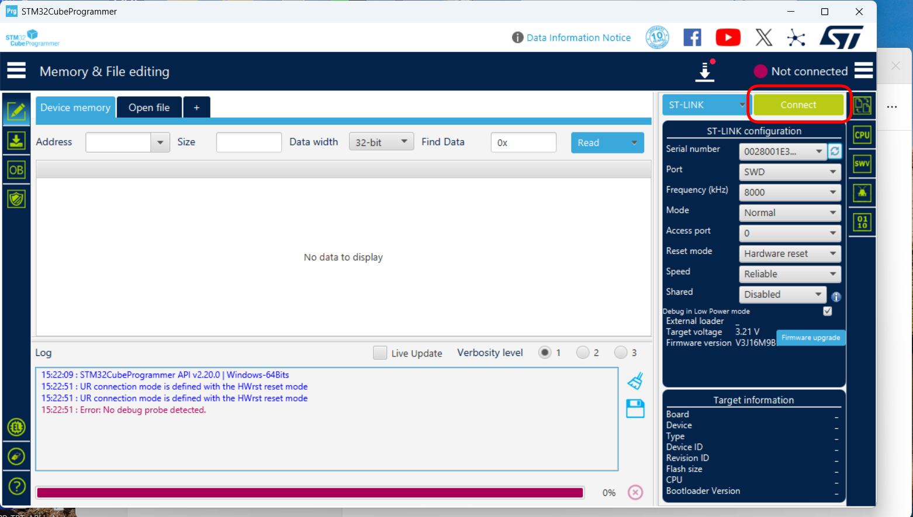
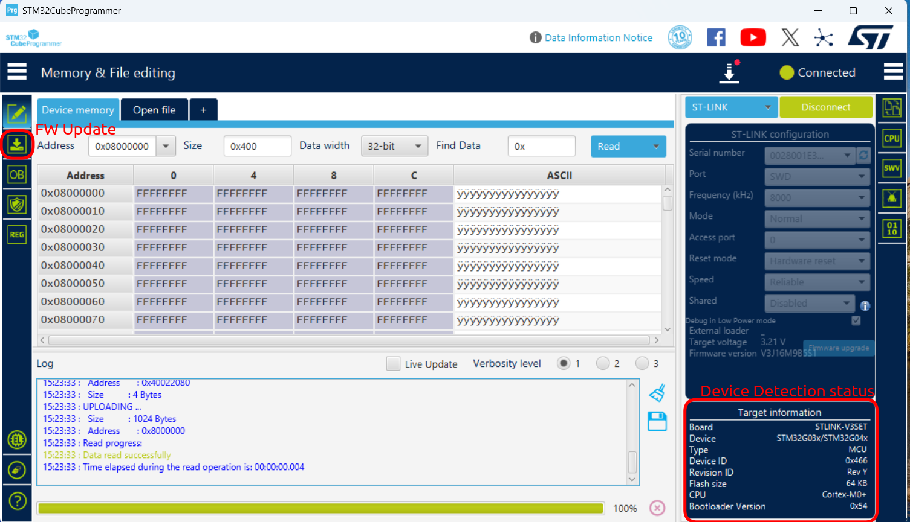
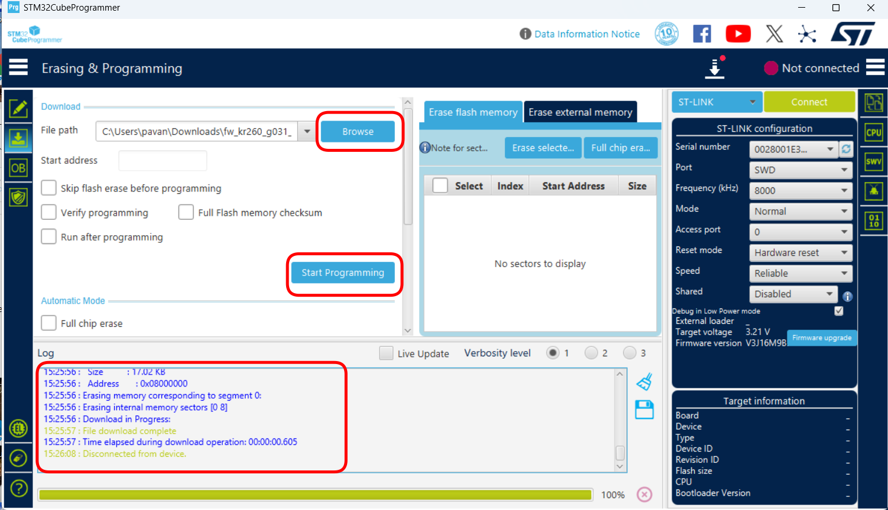
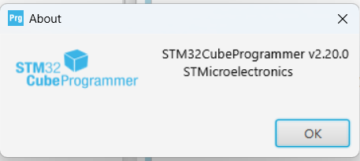

# Production Programming Guide — Reset Controller

## Document Control

| Field                 | Value                                                                |
| --------------------- | -------------------------------------------------------------------- |
| Product / assembly    | KR260 Reset Controller                                               |
| Target MCU            | STM32G031K8T6 (64 KB Flash, Arm Cortex-M0+)                          |
| Programmer            | STLINK-V3SET                                                         |
| Programming interface | SWD                                                                  |
| Programming software  | STM32CubeProgrammer v2.20.0 or approved production version           |
| Firmware file         | `fw_kr260_g031_reset.elf`                                          |
| Firmware revision     | `0.1`                                                              |
| Firmware SHA-256      | `6a8dfa501cb82b7f2b03ed420f9e6a9a8a9f8b62626d8c7e7b10ce98fb19ef2a` |
| Document revision     | Draft 0.1                                                            |
| Owner                 | `Prasanna \| Firmware Team`                                         |
| Effective date        | `16-10-2026`                                                       |

## 1. Purpose

This guide explains how to program the STM32G031K8T6 reset controller with an
approved `.elf` firmware file, using an STLINK-V3SET and the graphical interface
of STM32CubeProgrammer.

## 2. Required Items

- Production PC with an available USB port.
- STM32CubeProgrammer installed from the approved software package:
  [Download STM32CubeProgrammer](https://grlps-my.sharepoint.com/:u:/p/fw/IQBYrHkDFOZpR4nq0e218JvmAX4YjryZnAmpYM0LYK7fcXQ?e=R4d8rQ).
- Approved reset-controller firmware:
  [Download `fw_kr260_g031_reset.elf`](https://grlps-my.sharepoint.com/:u:/p/fw/IQCyygucqgodTKfWjiMmCHJUAUTN4A2FJllmqMPkATm5Q0g?e=Mvl4iP).
- STLINK-V3SET with USB cable.
- Approved programming cable, adapter, or production fixture.
- Carrier card and its approved power supply. The Kria SOM is **not required and
  must not be fitted during STM32 programming**.
- ESD-protected workstation and wrist strap.

## 3. Important Safety and Quality Rules

> **CAUTION — ESD:** Handle the board only at an ESD-protected workstation.

> **CAUTION — Wiring:** Turn target power off before connecting or disconnecting
> the programming cable. An offset or reversed connector may damage the target
> board or STLINK-V3SET.

> **CAUTION — Target power:** The STLINK-V3SET senses the target voltage through
> `VTref`; the production fixture must power the target board using its approved
> supply unless the fixture specification explicitly states otherwise. Do not
> assume the debug connector powers the board.

> **CAUTION — Option bytes:** Do not change Read Out Protection, write
> protection, boot configuration, or any other option byte unless a separate,
> approved production instruction explicitly requires it.

Use only the released `.elf` file identified in the work order and supplied
through the approved firmware link.

## 4. SWD Connections

Connect the approved fixture according to the board drawing. The minimum signals
required by this procedure are:

| STLINK-V3SET signal              | Target signal               | Purpose                                                  |
| -------------------------------- | --------------------------- | -------------------------------------------------------- |
| `VTref` / target voltage sense | Target I/O supply reference | Allows the probe to detect target logic voltage          |
| `GND`                          | Target ground               | Common electrical reference                              |
| `SWDIO`                        | MCU `SWDIO`               | Serial-wire bidirectional data                           |
| `SWCLK`                        | MCU `SWCLK`               | Serial-wire clock                                        |
| `NRST`                         | MCU reset                   | Required for the selected Hardware reset connection mode |

## 5. Before Programming

1. Download the approved firmware package and save it to the controlled local
   production folder.
2. Confirm the file name is exactly `fw_kr260_g031_reset.elf`.
3. Verify its SHA-256 checksum against the value in the **Document Control**
   table. If it does not match, stop and quarantine the file.
   Firmware revision `0.1` is not read back from the STM32; the approved file
   name and SHA-256 checksum identify the production firmware.
4. Confirm that the Kria SOM is not installed. Only the carrier card is required
   for programming the reset controller.
5. With carrier-card power **off**, connect the STLINK-V3SET to the target.
6. Connect the STLINK-V3SET to the PC by USB.
7. Apply the approved carrier-card power.

## 6. Connect to the Target

1. Open **STM32CubeProgrammer**.
2. Select **ST-LINK** as the connection type.
3. Set the ST-LINK configuration as follows:| Setting     | Approved value     |
   | ----------- | ------------------ |
   | Port        | `SWD`            |
   | Frequency   | `8000 kHz`       |
   | Mode        | `Normal`         |
   | Access port | `0`              |
   | Reset mode  | `Hardware reset` |
   | Speed       | `Reliable`       |
   | Shared      | `Disabled`       |
4. Confirm that the expected STLINK-V3SET serial number is displayed when the
   workstation or fixture controls probe assignment.
5. Select **Connect**.

6. Confirm that the top-right status changes to **Connected**.
7. Confirm the target information is consistent with the production device:| Displayed field | Expected result         |
   | --------------- | ----------------------- |
   | Board / probe   | `STLINK-V3SET`        |
   | Device family   | `STM32G03x/STM32G04x` |
   | Flash size      | `64 KB`               |
   | CPU             | `Cortex-M0+`          |

## 7. Program and Verify the Firmware

1. Select the **Erasing & Programming** icon in the left toolbar (down-arrow
   symbol).
2. In **File path**, select **Browse** and choose the approved
   `fw_kr260_g031_reset.elf` file.
3. Reconfirm the complete file name and its folder before continuing.
4. Set the programming options as follows:

   | Option                              | Required state                                     |
   | ----------------------------------- | -------------------------------------------------- |
   | Skip flash erase before programming | **Cleared**                                  |
   | Verify programming                  | **Selected**                                 |
   | Run after programming               | **Cleared**                                  |
   | Full Flash memory checksum          | Cleared unless required by the production traveler |

   For an `.elf` file, STM32CubeProgrammer obtains the programmed addresses from
   the file. Do not manually enter a start address.
5. Select **Start Programming**.
6. Do not remove power, unplug USB, move the fixture, or disconnect the cable
   while programming is in progress.
7. Wait for both programming and verification to finish.
8. Confirm the log reports successful download and verification with no red
   error messages. A download message without successful verification is not an
   acceptable production result.

> **Note:** The screenshot is a navigation aid. During the real procedure, keep
> the target connected and select **Verify programming**, even if the checkbox
> appears cleared in the example image.

## 8. Disconnect and Perform the Functional Check

### 8.1 Prepare the Assembly

1. Select **Disconnect** in STM32CubeProgrammer.
2. Turn carrier-card power off and allow the power rails to discharge.
3. Disconnect the STLINK-V3SET programming fixture from the carrier card.
4. Install the approved Kria SOM on the carrier card while power remains off.
5. Connect the normal boot media, serial console, network cable, and other test
   equipment required by the production test station.

### 8.2 Verify Power-On Boot

1. Capture the Kria boot console and apply normal product power.
2. Confirm that the Kria completes U-Boot and Linux startup, Please use the programmed SD Card.
3. Confirm that the console reaches `Reached target Login Prompts` and automatic
   login.
4. Record the power-on boot result as **Pass**.

### 8.3 Verify Soft-Reset Boot

1. Initiate the product's approved software reset while the system is running.
2. Confirm that a new boot sequence appears on the console without manually
   cycling carrier-card power.
3. Confirm that Linux again reaches `Reached target Login Prompts` and automatic login.
4. Record the soft-reset boot result as **Pass**.

### 8.4 Verify QSPI Firmware-Update Mode

1. Use the product's approved control sequence to request QSPI firmware-update
   mode.
2. Confirm that the console enters the recovery image and reports
   `QSPI 32 bit Boot Mode`.
3. Confirm that the console reports
   `Xilinx boot image recovery tool web server is running on port 80`.
4. Confirm that the firmware-update page is accessible at
   `http://192.168.0.111` from the test PC configured on the same subnet.
5. Record the QSPI firmware-update-mode result as **Pass**.

### 8.5 Complete the Test

1. Turn product power off after all three functional checks pass.
2. Record the results in the production log.
3. Apply the programmed/inspected label if required by the manufacturing plan.

The unit passes only when both of these conditions are met:

- STM32CubeProgrammer reports successful programming **and** verification.
- The product-specific functional test passes.

## 9. Troubleshooting

| Symptom                                           | Operator action                                                                                                                                                                                                       |
| ------------------------------------------------- | --------------------------------------------------------------------------------------------------------------------------------------------------------------------------------------------------------------------- |
| **No ST-LINK detected**                     | Check the USB cable and PC connection. Confirm the STLINK-V3SET power/status indicators. Try the approved spare USB cable or probe.                                                                                   |
| **No target voltage**                       | Confirm target power is on and `VTref` and `GND` are connected. Do not continue until the expected target voltage is present.                                                                                     |
| **Cannot connect to target**                | Turn power off; reseat the fixture; inspect `SWDIO`, `SWCLK`, `NRST`, `VTref`, and `GND`; power on and retry once. If permitted by the station instruction, reduce SWD frequency to `4000 kHz` and retry. |
| **Wrong device or Flash size**              | Stop. Verify that the correct board is loaded and that the fixture is correctly aligned. Do not program the unit.                                                                                                     |
| **ELF file rejected**                       | Confirm that the approved file was completely downloaded and has the expected `.elf` extension and SHA-256 checksum.                                                                                                |
| **Programming or verification fails**       | Do not mark the unit as passed. Power-cycle the target, inspect/reseat the fixture, and retry once. If it fails again, record the error and move the unit to the designated failure/quarantine area.                  |
| **Functional test fails after programming** | Repeat the functional test once according to its instruction. If it still fails, record the failure and quarantine the unit; do not repeatedly reprogram it unless authorized.                                        |

## 10. Reference — Software Version

The screenshots in this guide were captured with STM32CubeProgrammer v2.20.0.
Minor visual differences are acceptable only when the production team has
approved another software version and the required settings remain available.

